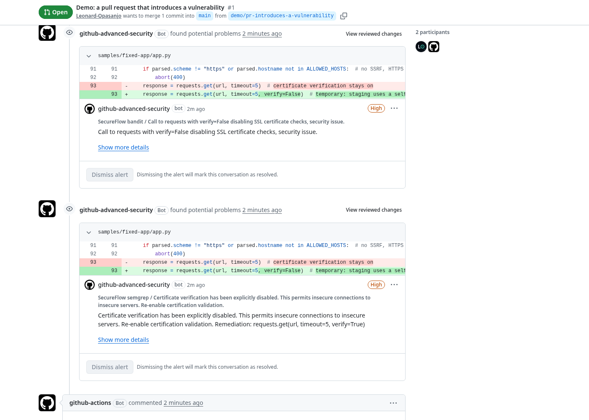
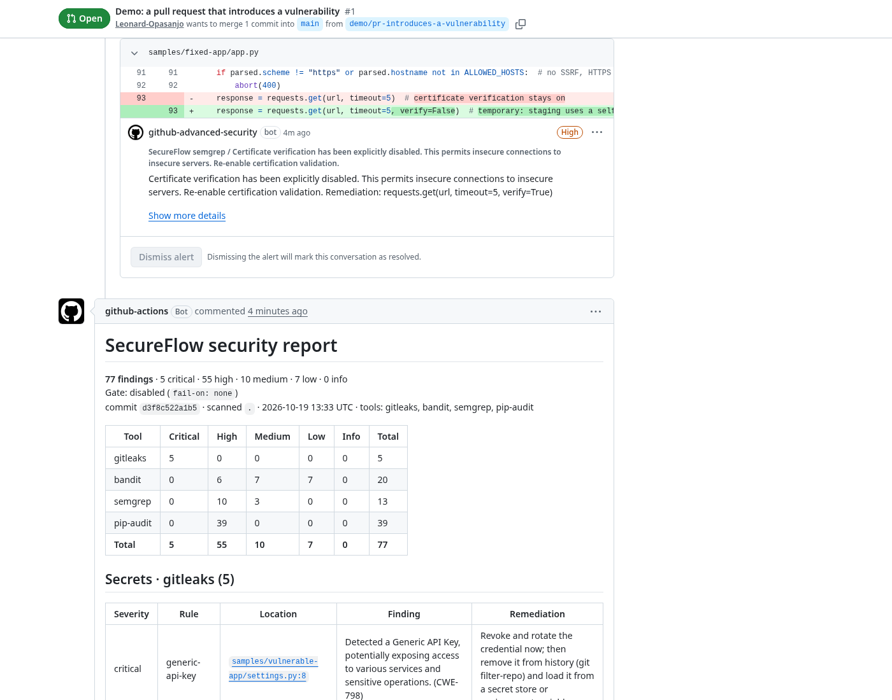
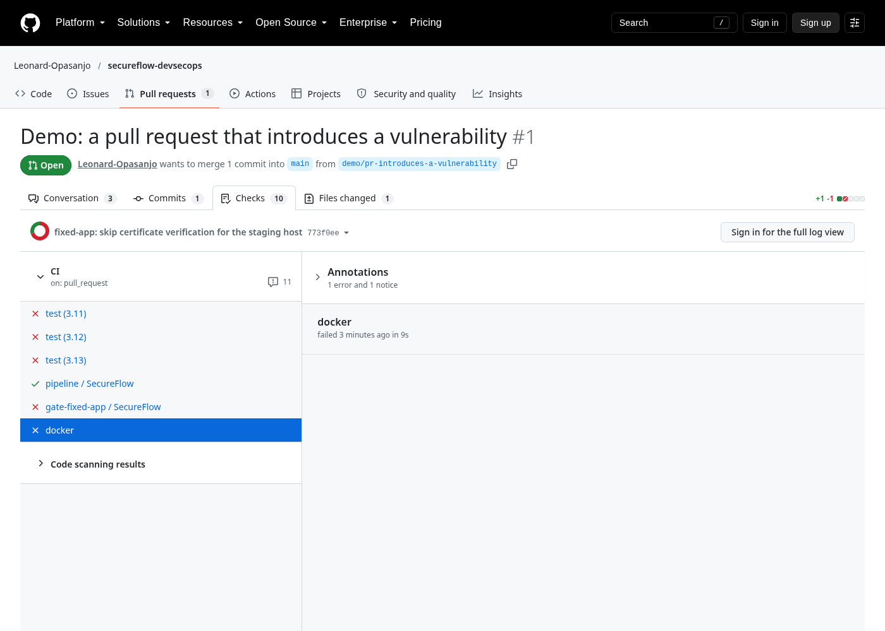
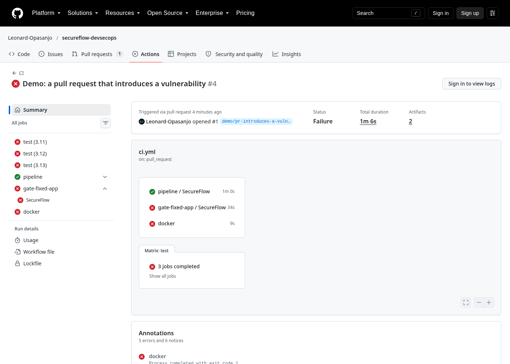

# SecureFlow

[](https://github.com/Leonard-Opasanjo/secureflow-devsecops/actions/workflows/ci.yml)
[](pyproject.toml)
[](LICENSE)

SecureFlow is a reusable DevSecOps pipeline for GitHub Actions. One `uses:` line in any repository runs four
scanners on every push and pull request, merges what they find into a single report with severities, publishes
the findings to the repository's Security tab, comments the report on the pull request, and fails the build when
anything crosses the severity you choose.

| Scanner | What it covers |
|---|---|
| [Bandit](https://bandit.readthedocs.io/) | Python static analysis: injection, weak crypto, unsafe deserialisation, bad defaults |
| [Semgrep](https://semgrep.dev/) | Multi-language static analysis with the `p/ci` and `p/security-audit` rulesets |
| [Gitleaks](https://github.com/gitleaks/gitleaks) | Committed credentials, across the full git history |
| [pip-audit](https://github.com/pypa/pip-audit) | Known vulnerabilities in Python dependencies, including transitive ones |

The repository also ships a deliberately vulnerable Flask application, its corrected twin, and a
[remediation guide](docs/REMEDIATION.md) that explains every finding and every fix. The pipeline runs on this
repository itself, so the [Security tab](https://github.com/Leonard-Opasanjo/secureflow-devsecops/security/code-scanning)
and the [Actions runs](https://github.com/Leonard-Opasanjo/secureflow-devsecops/actions) show it working on
real findings.

## Contents

- [See it running](#see-it-running)
- [Purpose](#purpose)
- [Objectives](#objectives)
- [Use it in your repository](#use-it-in-your-repository)
- [What happens on each run](#what-happens-on-each-run)
- [Inputs](#inputs)
- [The report](#the-report)
- [Severity mapping and the gate](#severity-mapping-and-the-gate)
- [Run it locally or in Docker](#run-it-locally-or-in-docker)
- [The sample applications](#the-sample-applications)
- [Architecture](#architecture)
- [Tests and continuous integration](#tests-and-continuous-integration)
- [Security of the pipeline itself](#security-of-the-pipeline-itself)
- [Limitations](#limitations)
- [Roadmap](#roadmap)
- [About this project](#about-this-project)
- [Licence](#licence)

## See it running

[Pull request #1](https://github.com/Leonard-Opasanjo/secureflow-devsecops/pull/1) is kept open on purpose: it
changes one line of the fixed sample to skip TLS certificate verification, the kind of "temporary" shortcut that
ships all the time. SecureFlow reacts in four places.

Code scanning annotates the exact line in the diff, with the finding from each scanner that caught it:



The report lands as a comment on the pull request and is updated in place on every push:



The gate on the fixed sample fails the check, while the reporting-only run on the whole repository passes:



And the same report is the job summary of every run, next to the artifact with the SARIF and JSON:



## Purpose

Most security problems that reach production were visible in the diff that introduced them: a query built with
string formatting, a `verify=False`, an API key pasted into a settings file, a dependency pinned two years ago.
The tools that spot these are free and mature. What small teams lack is the glue: installing four scanners,
remembering their flags, reading four output formats, deciding what counts as a failure, and getting the result
in front of the person who opened the pull request while they still care.

SecureFlow is that glue. It is the pipeline a security engineer would set up for a team on their first week,
packaged so that the next team gets it in one line. It makes no claim to find everything; the remediation guide
includes a flaw that none of the scanners catch, on purpose. Its claim is that the common, well-understood
mistakes get caught before merge, every time, with a report a developer can act on without a security
background.

## Objectives

1. **One line to adopt.** A caller workflow of five lines, no secrets to configure, no services to sign up for.
2. **Four scanners, one result.** Bandit, Semgrep, Gitleaks and pip-audit output normalised into a single
   finding model with one severity scale, de-duplicated, sorted, and rendered once.
3. **Findings where developers look.** The report goes to the job summary, to a comment on the pull request
   that updates in place instead of piling up, and to the Security tab as code scanning alerts via SARIF.
4. **A gate you control.** `fail-on: high` by default; `none` for reporting-only adoption; `low` for a
   repository that wants to stay spotless.
5. **Proof that it works.** A vulnerable sample with planted flaws that the pipeline must report, a fixed sample
   that it must pass, and a test suite that checks both on every CI run with the real scanners.
6. **Safe to run on untrusted pull requests.** Pinned, checksummed tool downloads, least-privilege permissions,
   workflow inputs passed through environment variables rather than interpolated into shell, secrets redacted
   in every output.

## Use it in your repository

Create `.github/workflows/security.yml`:

```yaml
name: Security

on:
  push:
    branches: [main]
  pull_request:

jobs:
  secureflow:
    uses: Leonard-Opasanjo/secureflow-devsecops/.github/workflows/secureflow.yml@main
    permissions:
      contents: read
      security-events: write   # publish to the Security tab
      pull-requests: write     # comment on pull requests
    with:
      fail-on: high
```

That is the whole integration. Pin `@main` to a tag or a commit SHA once you are happy with it, as you would
for any action. The scanned repository needs no Python project of its own: Bandit and pip-audit simply find
nothing to do if there is no Python code or `requirements*.txt`, while Semgrep and Gitleaks cover every
language.

A typical second step is to start with `fail-on: none`, look at the first report, fix or suppress what it
raises, then switch to `high`.

## What happens on each run

1. **Checkout** with full history when `scan-git-history` is on, so Gitleaks can see credentials that were
   committed and later removed.
2. **Install** Bandit, Semgrep and pip-audit from PyPI, the SecureFlow reporter from this repository at the
   same commit as the workflow file, and Gitleaks from its GitHub release, verified against a pinned SHA-256.
3. **Bandit** scans the `paths` for Python issues, excluding `.git`, `.venv`, `node_modules` and `tests`/`test`
   directories (asserts and subprocess calls in tests are not vulnerabilities; Semgrep and Gitleaks still cover them).
4. **Semgrep** scans the same paths with the configured rulesets, metrics off.
5. **Gitleaks** scans the git history (default) or the working tree of each path, with `--redact` so no secret
   value ever appears in logs, artifacts, comments or alerts.
6. **pip-audit** runs once per `requirements*.txt` found under the paths, resolving the full dependency tree so
   that transitive packages are audited too. A file that cannot be resolved fails the step loudly rather than
   being skipped silently.
7. **Report.** The `secureflow report` command reads the four outputs, normalises and de-duplicates them, and
   writes `secureflow-report.md`, `secureflow.sarif` and `secureflow-findings.json`. The Markdown goes to the
   job summary.
8. **Publish.** The three files are uploaded as a job artifact; the SARIF goes to code scanning under the
   category `secureflow`; on pull requests the Markdown is posted as a comment, replacing the previous one from
   SecureFlow. Both publishing steps are `continue-on-error`, so a repository where code scanning is off or a
   fork without write access still gets the report and the gate.
9. **Gate.** `secureflow gate` exits non-zero when any finding is at or above `fail-on`, which fails the job.
   It runs last, after everything has been published, so a failed gate never hides the report.

## Inputs

| Input | Default | Meaning |
|---|---|---|
| `paths` | `.` | Space-separated directories for Bandit, Semgrep and the `requirements*.txt` search |
| `python-version` | `3.12` | Python used to run the scanners |
| `fail-on` | `high` | Fail when any finding is at or above this: `none`, `low`, `medium`, `high`, `critical` |
| `semgrep-config` | `p/ci p/security-audit` | Space-separated Semgrep rulesets or rule files. `p/ci` alone is quieter |
| `scan-git-history` | `true` | Gitleaks scans all commits; `false` scans only the working tree of `paths` |
| `upload-sarif` | `true` | Publish to code scanning |
| `comment-on-pr` | `true` | Post or update the report comment on pull requests |

Example with everything set:

```yaml
    with:
      paths: "src services/api"
      python-version: "3.11"
      fail-on: medium
      semgrep-config: "p/ci p/owasp-top-ten .semgrep/custom.yml"
      scan-git-history: false
```

## The report

The report leads with the verdict, then a matrix of severity by tool, then one table per tool. An excerpt: Locations link
to the exact line at the scanned commit, rule ids link to the scanner's documentation or the OSV record, and
every row carries a remediation where the scanner provides one.

```markdown
# SecureFlow security report

**41 findings** · 5 critical · 18 high · 10 medium · 8 low · 0 info
Gate `high`: **FAIL** (23 at high or above)
commit `3f2a1c9d0e7b` · scanned `.` · 2026-10-19 13:00 UTC · tools: gitleaks, bandit, semgrep, pip-audit

| Tool | Critical | High | Medium | Low | Info | Total |
|---|---|---|---|---|---|---|
| gitleaks | 5 | 0 | 0 | 0 | 0 | 5 |
| bandit | 0 | 5 | 7 | 8 | 0 | 20 |
| semgrep | 0 | 6 | 6 | 0 | 0 | 12 |
| pip-audit | 0 | 4 | 0 | 0 | 0 | 4 |
| **Total** | **5** | **18** | **10** | **8** | **0** | **41** |

## Secrets · gitleaks (5)

| Severity | Rule | Location | Finding | Remediation |
|---|---|---|---|---|
| critical | github-pat | [`samples/vulnerable-app/settings.py:9`](…#L9) | Uncovered a GitHub Personal Access Token … (CWE-798) | Revoke and rotate the credential now; then remove it from history … |
```

The same content is available three ways:

- `secureflow-report.md` in the job summary, the PR comment and the artifact: for people.
- `secureflow.sarif`: SARIF 2.1.0 with one run per tool, rule metadata, `security-severity` scores so GitHub
  shows the right severity, and stable partial fingerprints so an alert survives line shifts. This is what the
  Security tab renders, with one alert per finding that can be dismissed, assigned and tracked.
- `secureflow-findings.json`: every field of every finding, the counts, the configuration and the gate result.
  This is the input to `secureflow gate` and the right file for a dashboard or a ticketing integration.

## Severity mapping and the gate

Each scanner has its own idea of severity. SecureFlow maps them onto one scale:

| Scanner | Mapping |
|---|---|
| Gitleaks | every leak is **critical**: the fix is rotation, and nothing else in the report matters until it is done |
| Bandit | `HIGH` → high, `MEDIUM` → medium, `LOW` → low |
| Semgrep | `ERROR` → high, `WARNING` → medium, `INFO` → low; a `WARNING` whose rule metadata says `impact: HIGH` is raised to high |
| pip-audit | every advisory is **high**; pip-audit's output carries no score, and a known-vulnerable dependency reachable from your code is a high by any policy |

Findings are de-duplicated on `tool + rule + file + line`, so a secret present in ten commits is one finding,
and the SARIF scores map to GitHub's bands (critical 9.5, high 8.0, medium 5.5, low 3.0).

The gate compares every finding against `fail-on`. `secureflow gate` prints the breaching findings and exits 1;
the job fails; the report has already been published. Set `fail-on: none` to report without blocking.

## Run it locally or in Docker

The container holds all four scanners and the reporter, runs as an unprivileged user (uid 1000), and writes its
output to `.secureflow/` inside the mounted directory. If that directory is not writable by uid 1000 (a CI
checkout owned by another user, or a read-only mount) the report goes to a temporary directory inside the
container instead and the path is printed; the gate result is the same either way.

```bash
docker build -t secureflow .
docker run --rm -v "$PWD:/src" secureflow                           # scan the current directory, gate at high
docker run --rm -v "$PWD:/src" -e SECUREFLOW_FAIL_ON=low secureflow  # stricter gate
cat .secureflow/report.md
```

Without Docker, install the scanners and run the same script:

```bash
pip install -e ".[dev]"            # reporter plus bandit, semgrep, pip-audit (and the test tools)
# gitleaks: download the release binary for your platform and put it on PATH
scripts/secureflow-local.sh .       # or any directory; SECUREFLOW_FAIL_ON, SECUREFLOW_SEMGREP_CONFIG, SECUREFLOW_OUT
```

The reporter on its own has no dependencies beyond the standard library and can be used with scanner output
you produced some other way:

```bash
secureflow report --bandit bandit.json --semgrep semgrep.json --gitleaks gitleaks.json \
                  --pip-audit pip-audit.json:requirements.txt \
                  --markdown report.md --sarif out.sarif --json findings.json \
                  --commit "$(git rev-parse HEAD)" --repo https://github.com/you/repo --fail-on high
secureflow gate findings.json --fail-on high
```

`--gitleaks` and `--pip-audit` repeat; `--pip-audit` takes `JSON[:REQUIREMENTS]` so each advisory can point at
the line that pins the package. A missing or empty scanner file counts as "ran, found nothing".

## The sample applications

`samples/vulnerable-app` is a small Flask service with fourteen weaknesses planted on purpose: SQL built with an
f-string, a shell command built from a query parameter, `eval` on user input, `pickle` and full-loader YAML on
request bodies, MD5 for passwords, `random` for session tokens, TLS verification off, `mktemp`, a world-writable
file, a swallowed exception, the debugger bound to all interfaces, six fake credentials in `settings.py`, and a
`requirements.txt` pinned to versions with published advisories. `samples/fixed-app` is the same service with each
one corrected.

With the current rules and advisory databases the vulnerable app produces about 75 findings: 5 secrets, 19 from
Bandit, 12 from Semgrep and close to 40 dependency advisories (that last number only grows as new advisories
are published). The fixed app produces none. [docs/REMEDIATION.md](docs/REMEDIATION.md) walks through every finding: the rule that
fires, what an attacker does with it, the fix in the corrected app, and the CWE and OWASP references. It also
covers one flaw the scanners miss (server-side request forgery), triage order, and how to suppress a finding
you have reviewed.

## Architecture

```
.github/workflows/secureflow.yml   the reusable workflow (workflow_call): install, scan, report, publish, gate
.github/workflows/ci.yml           this repository's CI: tests on 3.11-3.13, the pipeline on itself, the gate on the fixed app, Docker
secureflow/
├── findings.py    Finding dataclass, the severity scale, SARIF level and score tables, path normalisation, fingerprints
├── parsers.py     one function per scanner: JSON in, list[Finding] out
├── report.py      dedupe, counts, gate, Markdown, SARIF 2.1.0, JSON
└── cli.py         `secureflow report` and `secureflow gate`
scripts/secureflow-local.sh        runs the scanners and the reporter on a directory; the container's entrypoint
samples/                           vulnerable-app and fixed-app
docs/REMEDIATION.md                finding-by-finding explanation and fixes
tests/                             unit tests on real scanner output in tests/fixtures, plus the scanners run against both samples
```

Design decisions:

- **The reporter is plain Python with no dependencies.** It installs in a second from a git URL at the exact
  commit of the workflow, so the workflow and the code that interprets its output can never drift apart.
- **Scanners are run by the workflow, not by the reporter.** Each scanner's flags, exclusions and exit codes
  are visible in the YAML where an operator expects them, and a scanner crash fails its own step with its own
  log rather than being swallowed by a wrapper.
- **One finding model.** Every parser maps to the same eleven fields. Adding a scanner is one parser function,
  one CLI flag, one workflow step and a fixture.
- **Report before gate.** Uploads and comments happen before the gate step, so a red build still carries its
  evidence.
- **SARIF per tool, one upload.** Each tool is its own SARIF run with its own rules, under one code-scanning
  category, so alerts show which scanner raised them and are closed automatically when the next run no longer
  reports them.

## Tests and continuous integration

```bash
ruff check .
pytest                                    # 29 tests
bandit -q -c pyproject.toml -r secureflow
pip-audit
```

The unit tests run the parsers and the report on real scanner output captured from the vulnerable app
(`tests/fixtures`), check Markdown escaping and links, SARIF structure, de-duplication and ordering, the gate at
every threshold, and the CLI's exit codes. The integration tests in `tests/test_samples.py` run Bandit, Semgrep,
Gitleaks and pip-audit for real against both sample applications and assert that the vulnerable one is flagged
and the fixed one is clean; they skip only if a scanner is not installed.

The CI workflow has four jobs:

| Job | What it proves |
|---|---|
| `test` (3.11, 3.12, 3.13) | lint, the test suite with all four scanners present, Bandit on the reporter, pip-audit on its environment |
| `pipeline` | the reusable workflow runs on this repository with `fail-on: none`; its findings are the live demo in the Security tab |
| `gate-fixed-app` | the reusable workflow on `samples/fixed-app` with `fail-on: low` must pass |
| `docker` | actionlint on the workflow files, the image builds, and the container passes on the fixed app |

## Security of the pipeline itself

A security workflow runs on every pull request, including ones from strangers, so it has to be careful about
its own attack surface.

- **No script injection.** Workflow inputs are passed to shell steps through environment variables, never
  interpolated with `${{ }}` into `run:` blocks.
- **Pinned, verified downloads.** Every third-party action is pinned to a commit SHA, with Dependabot proposing
  updates. Gitleaks is fetched from its GitHub release at a fixed version and checked against a SHA-256 recorded
  in the workflow and the Dockerfile. The reporter is installed from this repository at the commit of the
  workflow file.
- **Least privilege.** The job asks for `contents: read`, `security-events: write` and `pull-requests: write`
  and nothing else. Callers grant exactly those.
- **Secrets never leave the runner.** Gitleaks runs with `--redact`; the report, the artifact, the comment and
  the SARIF carry the location and the rule, not the value.
- **Untrusted code is scanned, not executed.** Bandit, Semgrep and Gitleaks read files. pip-audit resolves
  dependencies, which means it downloads packages named in `requirements*.txt`; it does not import or run them.
- **Publishing cannot be used to break the gate.** The upload and comment steps are `continue-on-error`; the
  gate step is independent of them.
- Report a problem with the pipeline itself through [SECURITY.md](SECURITY.md).

## Limitations

- Dependency auditing covers Python only. JavaScript, Go and other ecosystems get Semgrep and Gitleaks but no
  advisory lookup yet.
- Semgrep's registry rulesets are fetched at run time, so a run needs network access and the rules can change
  between runs. Pin a rule file in your repository for fully reproducible results.
- Static analysis finds patterns, not logic. The remediation guide's SSRF example is a reminder that review and
  testing are still required.
- pip-audit's resolution installs packages into a temporary environment on the runner. Requirements with build
  dependencies or private indexes may need extra setup.
- Code scanning alerts require the feature to be available on the repository (free for public repositories,
  GitHub Advanced Security for private ones). Without it the SARIF upload is skipped and the report still lands
  in the summary, artifact and comment.
- Weekly scheduled runs, which catch newly published advisories in unchanged code, are left to the caller to
  add with a `schedule:` trigger.

## Roadmap

- `osv-scanner` or `trivy` as a second dependency auditor for `package-lock.json`, `go.sum` and `Cargo.lock`.
- A `baseline` input that suppresses findings already present on the default branch, so a legacy codebase can
  adopt `fail-on: high` for new code immediately.
- Container image scanning when a `Dockerfile` is present.
- A `check-run` output with per-line annotations in the pull request diff.
- Trend data across runs, stored as an artifact, for a small dashboard.

## About this project

SecureFlow is the second in a series of open-source security tools I am building to show practical security
engineering on real code: working automation, tests that prove it, documentation that explains the reasoning,
and samples anyone can experiment on. The first is [LogSentinel](https://github.com/Leonard-Opasanjo/logsentinel),
an authentication-log analyser. This one covers the other side of the job: stopping the vulnerability before it
ships rather than finding the intrusion afterwards.

Issues and pull requests are welcome. [CONTRIBUTING.md](CONTRIBUTING.md) explains how to add a scanner or a
sample.

## Licence

MIT. See [LICENSE](LICENSE).
